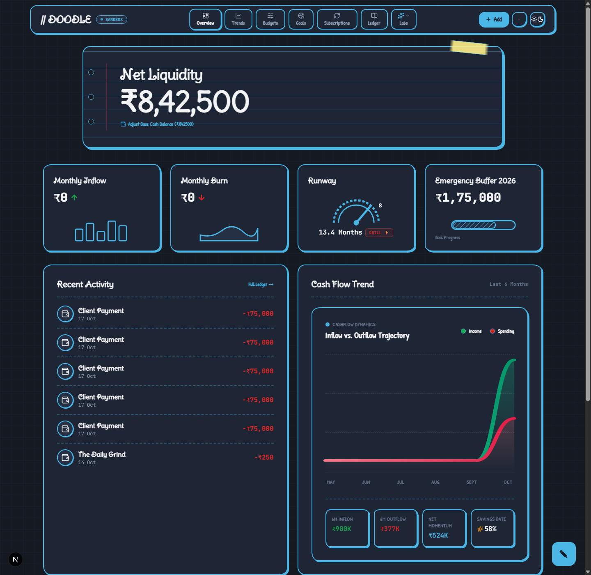
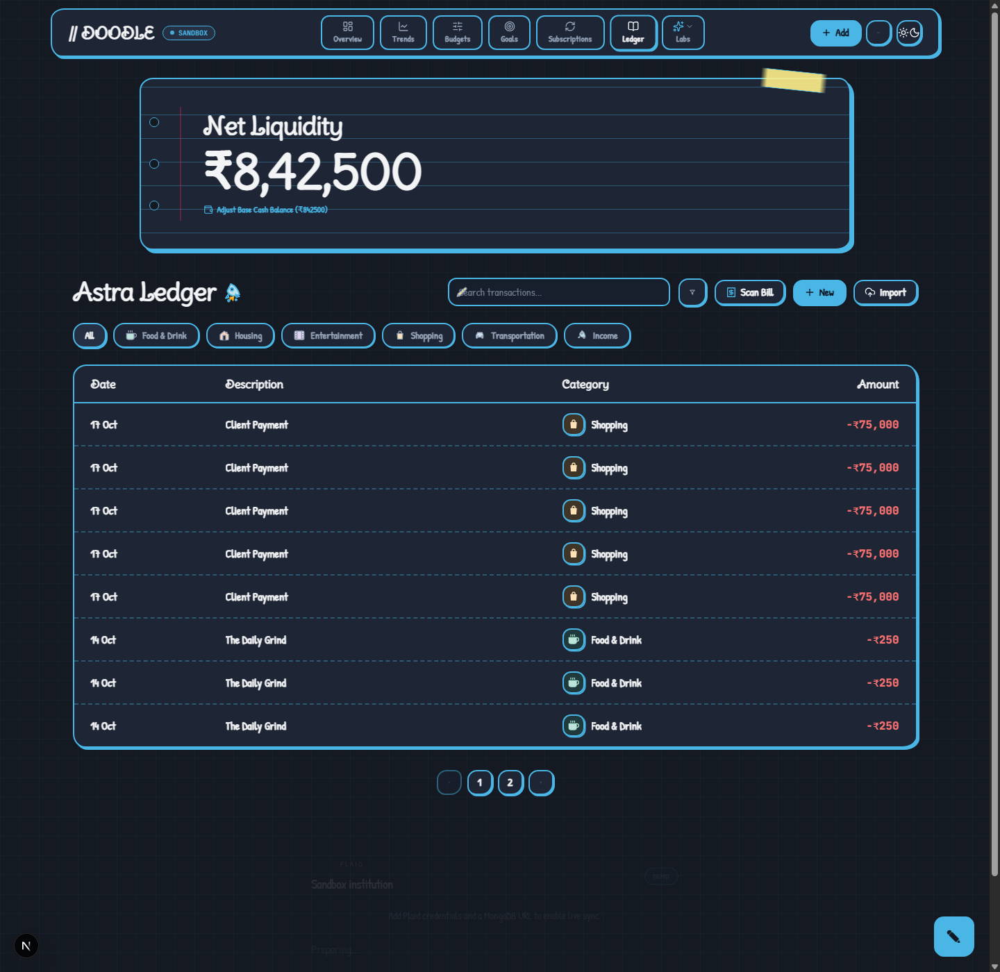
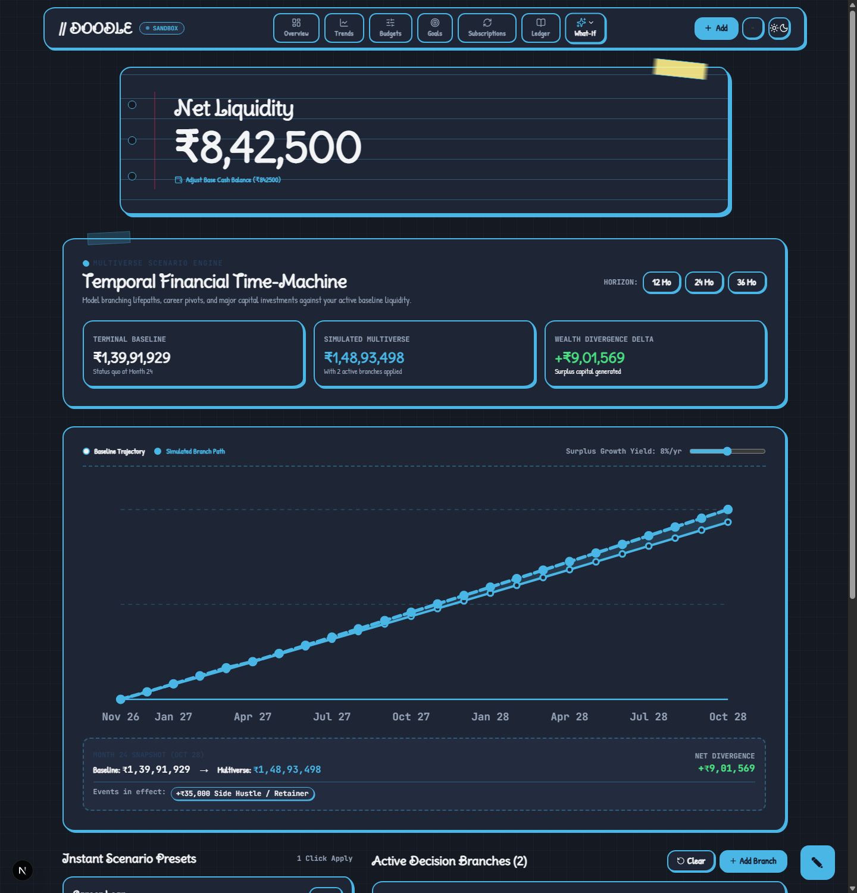
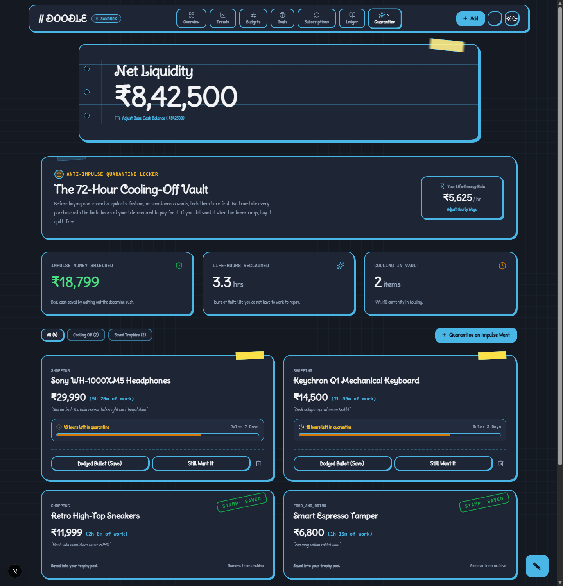
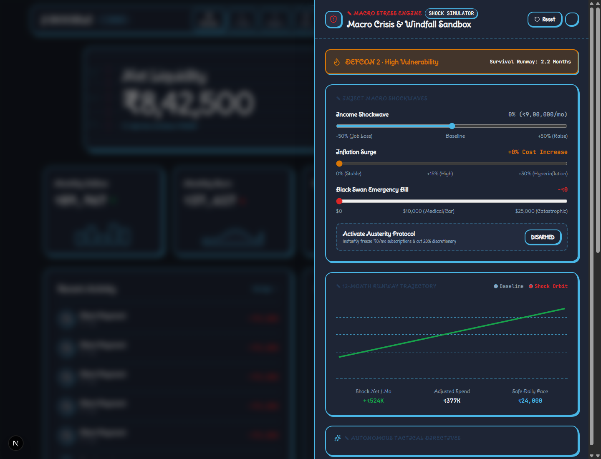
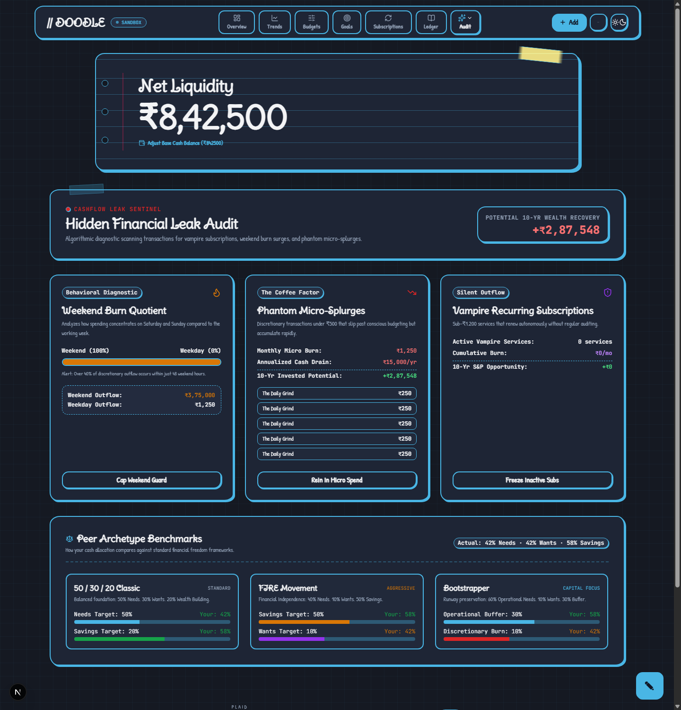
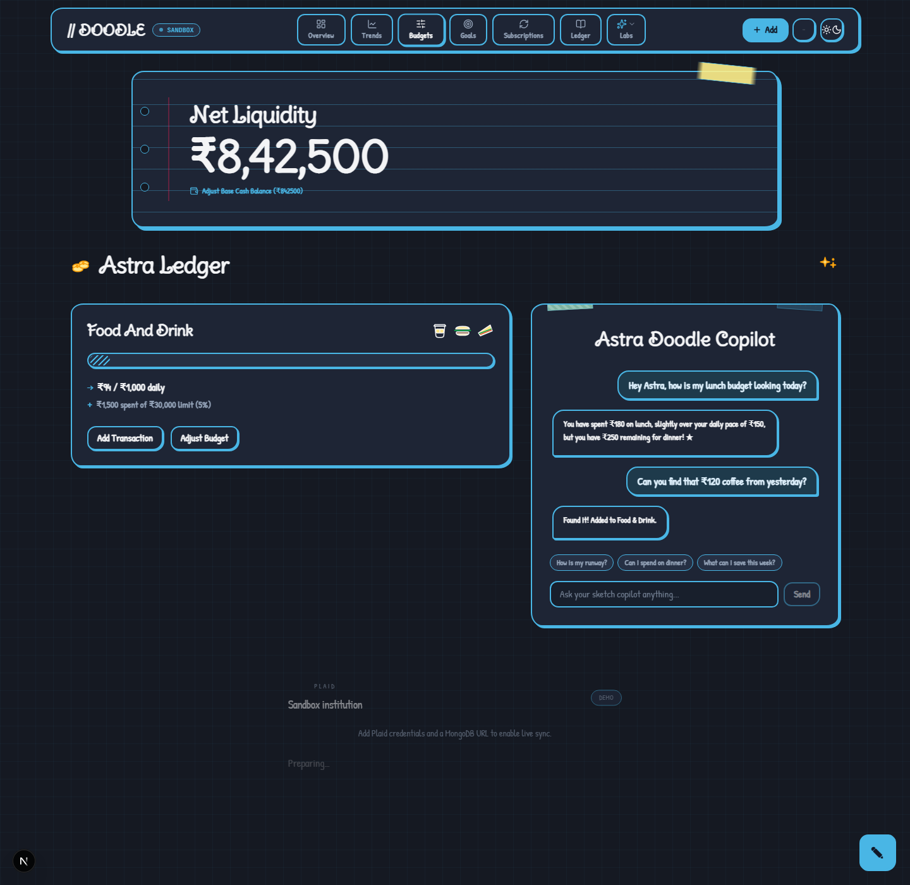
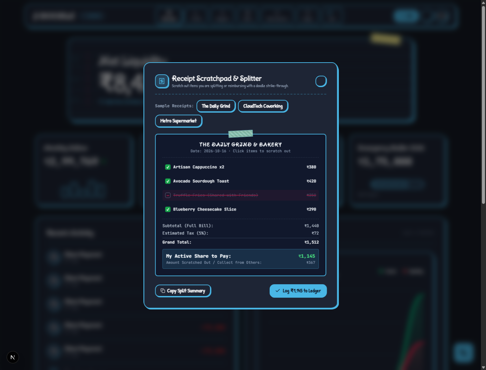
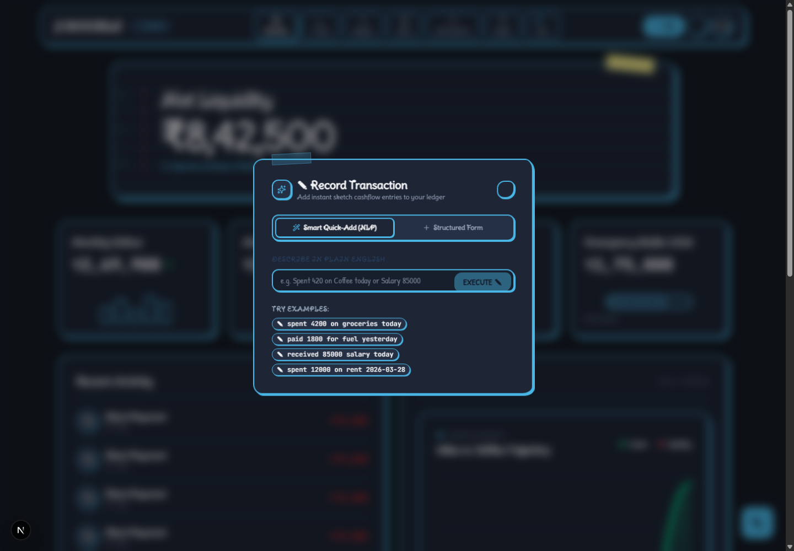

# Astra Ledger

Astra Ledger is an offline-first, hand-drawn financial sketchbook and personal finance command center built with Next.js 16 (Turbopack), TypeScript, Tailwind CSS 4, Framer Motion, and the TypeUI Doodle design system.

It merges the tactile charm of a physical bullet journal with advanced financial modeling: interactive scenario branching, anti-impulse cooling lockers, macroeconomic catastrophe stress tests, subscription leak sentinels, bill-splitting scratchpads with pencil strike-throughs, natural-language transaction entry, and an integrated AI copilot.

---

## Visual Previews and Browser Output Screenshots

The screenshots below are actual high-resolution browser captures from the live application running in local development.

### 1. Financial Overview and Net Liquidity Notebook



Hand-drawn binder notebook dashboard featuring Net Liquidity metrics with punched margin binder rings, red margin notebook rule, monthly burn gauges, survival runway speedometer, and cashflow trajectory curves.

---

### 2. Astra Ledger and Filterable Journal



Complete transactional sketchbook with pencil search, hand-drawn category filter chips (Food & Drink, Housing, Entertainment, Shopping, Transportation, Income), tactile striped row cards, amount indicators, Scan Bill button, and batch Excel importer.

---

### 3. Temporal Financial Time-Machine (Multiverse Branching)



Interactive financial simulation engine. Model career pivots, side hustles, relocations, and capital investments across 12, 24, and 36 month horizons. Features dynamic compound yield curves, branch stacking, and live wealth divergence delta tracking against your baseline liquidity.

---

### 4. The 72-Hour Anti-Impulse Quarantine Vault



Behavioral cooling-off holding locker for spontaneous purchases. Automatically translates item prices into finite hours of your life required to earn them based on your hourly wage. Features cooling countdown timers, a Dodged-Bullet trophy pool, and one-click conversion to ledger transactions.

---

### 5. Macroeconomic Crisis Stress-Test Engine



Defcon-rated macroeconomic catastrophe simulator. Test your liquidity against simultaneous income shocks (-50% job loss), runaway inflation surges (+30% hyperinflation), and sudden black swan medical bills. Includes a one-click Austerity Protocol to immediately freeze non-essential spending.

---

### 6. Cashflow Leak Sentinel and Archetype Benchmarking



Algorithmic audit sentinel analyzing weekend burn concentration, phantom micro-splurges (the coffee factor), and vampire recurring subscriptions. Benchmarks your net allocation against institutional models: 50/30/20 Classic, FIRE Movement, and Bootstrapper.

---

### 7. Envelope Budgets and Astra Doodle Copilot



Category spending limits with daily pace tracking and overspend warnings alongside the Astra Doodle Copilot: an embedded AI financial assistant supporting Groq (free tier) and OpenAI for runway calculations and contextual recommendations.

---

### 8. Receipt Scratchpad and Interactive Splitter



Tactile paper receipt modal with simulated tape headers. Click any item on your grocery or dining receipt to apply a hand-drawn red pencil strike-through for shared meals or reimbursable items, instantly recalculating your net share to log to the ledger.

---

### 9. Natural Language Smart Quick-Add



Modal for lightning-fast expense recording. Type in everyday English (e.g., "Spent 420 on Coffee today" or "received 85000 salary today") and Astra parses the title, amount, category, and date automatically.

---

## Core Capabilities

- **Hand-Drawn Tactile Design System**: Built with TypeUI Doodle design foundations: hand-crafted irregular border radii, notebook binder punch-holes, pink margin guidelines, graph-paper grid backdrops (28px), and tactile physical buttons with active press feedback.
- **Dual Paper Themes**:
  - **Light Sketchbook**: Clean cream paper (`#FBF9F4`) with deep navy ink outlines (`#263D5B`) and pencil graphite typography.
  - **Dark Chalkboard**: Deep slate background (`#151922`) with doodle cyan borders (`#49B6E5`) and chalk-white text.
- **Zero Gimmicks Architecture**: No resource-heavy 3D WebGL canvases, no cursor hijacking, and no synthetic audio chirps. 100% native browser responsiveness.
- **Streamlined Command Header**: Minimalist 3-item right cluster (+ Add transaction, ... Tools dropdown, Theme toggle) keeping the notebook spacious and legible.
- **Complete View Navigation**:
  - **Overview (Key 1)**: Net liquidity, monthly inflow/outflow, runway speedometer, recent activity feed, and 6-month cashflow curves.
  - **Trends (Key 2)**: Monthly cashflow trajectory splines, category share distribution, and top recipient entity leaderboards.
  - **Budgets (Key 3)**: Category envelope ceilings with daily pace indicators and embedded Astra Copilot.
  - **Goals (Key 4)**: Milestone targets with progress tracks, target dates, and celebratory confetti triggers.
  - **Subscriptions (Key 5)**: Fixed obligation radar with an interactive pruning simulator showing runway extensions.
  - **Ledger (Key 6)**: Filterable, searchable transaction journal with CSV export and Excel batch ingestion.
  - **What-If Multiverse (Key 7)**: Scenario branching engine with timeline divergence calculations and compound growth yield dials.
  - **Leak Audit Sentinel (Key 8)**: Diagnostic detector for weekend spending spikes, micro-spend accumulation, and vampire subscriptions.
  - **Quarantine Vault (Key 9)**: 72-hour cooling locker with life-energy hourly rate calculators and saved trophy shelf.
  - **Crisis Stress-Test (Key 0)**: Defcon catastrophe drill with macro shock dials and instant austerity toggles.
- **Dual Persistence Engines**:
  - **Zero-Config Local / Serverless**: Local JSON file workspace with automatic in-memory fallback for Vercel serverless deployments.
  - **MongoDB with Prisma ORM**: Optional production database backend for multi-account syncing.
- **Plaid Sandbox Integration**: Optional bank linking via Plaid Link for automated account balances and transaction categorization.

---

## Tech Stack

| Layer | Technology |
| :--- | :--- |
| Framework | Next.js 16 (App Router, Turbopack) |
| Language | TypeScript 5 |
| Styling | Tailwind CSS 4, Vanilla CSS Design Tokens |
| Design System | TypeUI Doodle (Hand-drawn SVG filters, doodle borders, washi tape) |
| Typography | Delius Swash Caps (Display), Patrick Hand (Body & UI), JetBrains Mono (Numbers & Code) |
| Motion | Framer Motion 12 |
| Database & ORM | Prisma 6, MongoDB (Optional) |
| Banking Sync | Plaid Node SDK, React Plaid Link (Optional) |
| AI Copilot | Groq SDK (Llama 3.3 free tier) / OpenAI API (Optional) |
| Spreadsheet Import | SheetJS (XLSX) |
| Visual FX | Canvas Confetti |

---

## Project Structure

```text
Astra_Ledger/
├── data/                       # Local file-based workspace storage (fallback)
├── prisma/
│   └── schema.prisma           # Prisma schema for MongoDB (Plaid, accounts, transactions)
├── public/
│   └── screenshots/            # Real output browser screenshots (PNG)
│       ├── overview.png
│       ├── ledger.png
│       ├── simulator.png
│       ├── quarantine.png
│       ├── crisis_stress_test.png
│       ├── audit.png
│       ├── budgets.png
│       ├── analytics.png
│       ├── receipt_scanner.png
│       └── quick_add.png
├── src/
│   ├── app/
│   │   ├── api/                # REST endpoints (transactions, budgets, goals, copilot, plaid)
│   │   ├── globals.css         # TypeUI Doodle design tokens, fonts, and utilities
│   │   ├── layout.tsx          # Root layout and Google Font preloads
│   │   └── page.tsx            # Main server-rendered dashboard entrypoint
│   ├── components/             # Hand-drawn UI modules
│   │   ├── dashboard-shell.tsx # Main command bar, tab switcher, and balance modal
│   │   ├── overview-tab.tsx    # Net worth, runway gauge, and activity feed
│   │   ├── analytics-tab.tsx   # Cashflow splines, category breakdowns, and top payees
│   │   ├── budgets-tab.tsx     # Monthly budget caps and burn indicators
│   │   ├── goals-tab.tsx       # Milestone savings targets
│   │   ├── recurring-tab.tsx   # Subscriptions and pruning simulator
│   │   ├── ledger-tab.tsx      # Filterable transaction notebook
│   │   ├── what-if-simulator.tsx # Multiverse scenario branching engine
│   │   ├── financial-leak-audit.tsx # Sentinel audit for weekend burn and vampire subs
│   │   ├── quarantine-vault.tsx # Anti-impulse 72-hour cooling locker
│   │   ├── stress-test-drawer.tsx # Macroeconomic crisis sandbox
│   │   ├── receipt-scanner-modal.tsx # Scratchpad bill splitter with pencil lines
│   │   ├── quick-add-modal.tsx # Natural-language transaction entry
│   │   ├── finance-chat-panel.tsx # Floating Doodle Copilot drawer
│   │   ├── depth-hero.tsx      # Notebook binder cover with punch-holes and margin rule
│   │   └── theme-toggle.tsx    # Light/Dark mode switcher
│   └── lib/                    # Business logic, calculations, and database clients
│       ├── dashboard.ts        # Aggregated metrics and sample dataset
│       ├── finance.ts          # Currency formatters and calculations
│       ├── workspace-store.ts  # File-based and serverless memory persistence
│       └── db.ts               # Prisma MongoDB singleton client
├── vercel.json                 # Vercel deployment configuration
├── package.json
└── README.md
```

---

## Keyboard Shortcuts

Navigate Astra Ledger with physical keyboard commands:

| Key | Action |
| :--- | :--- |
| `1` | Open Overview Tab (Net Liquidity, Runway, Recent Activity) |
| `2` | Open Trends Tab (Cashflow Splines, Category Breakdown) |
| `3` | Open Budgets Tab (Envelopes, Spending Caps, Astra Copilot) |
| `4` | Open Goals Tab (Milestone Targets, Celebrations) |
| `5` | Open Subscriptions Tab (Recurring Radar, Pruning Simulator) |
| `6` | Open Ledger Tab (Full Searchable Transaction Journal) |
| `7` | Open What-If Multiverse Engine (Branching Scenarios) |
| `8` | Open Financial Leak Audit Sentinel (Weekend Burn, Coffee Factor) |
| `9` | Open Impulse Quarantine Locker (Cooling Timers, Life-Energy) |
| `0` | Open Macroeconomic Crisis Stress-Test Drawer |
| `Ctrl + K` or `N` | Open Smart Quick-Add Transaction Modal |
| `R` | Open Receipt Scratchpad and Bill Splitter |
| `T` | Toggle Theme (Light Sketchbook / Dark Chalkboard) |
| `D` | Toggle Demo Mode (Sample Data / Blank Slate) |
| `?` | Open Keyboard Shortcuts Reference Modal |
| `Esc` | Close Active Modal, Dropdown, or Drawer |

---

## Getting Started

### 1. Prerequisites

- Node.js 20.x or newer
- npm 10.x or newer

### 2. Installation

Clone the repository and install dependencies:

```bash
git clone https://github.com/Dhuvie/Astra_Ledger.git
cd Astra_Ledger
npm install
```

### 3. Environment Configuration

Copy the example environment file:

```bash
cp .env.example .env.local
```

On Windows PowerShell:

```powershell
Copy-Item .env.example .env.local
```

Astra Ledger runs out of the box with zero required environment variables. To enable optional live services, configure:

```env
# Optional: MongoDB connection string for persistent multi-account database
DATABASE_URL="mongodb+srv://<user>:<password>@cluster.mongodb.net/astra_ledger?retryWrites=true&w=majority"

# Optional: Plaid Sandbox credentials (from https://dashboard.plaid.com)
PLAID_CLIENT_ID="your_plaid_client_id"
PLAID_SECRET="your_plaid_secret"
PLAID_ENV="sandbox"

# Optional: Free Groq AI key for Astra Copilot (from https://console.groq.com)
GROQ_API_KEY="your_groq_api_key"
```

### 4. Running Locally

Start the development server with Turbopack:

```bash
npm run dev
```

Open [http://localhost:3000](http://localhost:3000) in your browser.

---

## Deploying to Vercel

Astra Ledger includes dedicated Vercel deployment arrangements configured in `vercel.json` and `src/lib/workspace-store.ts`.

### Option A: Deploy via Vercel Dashboard (Recommended)

1. Push your repository to GitHub, GitLab, or Bitbucket.
2. Log in to [Vercel](https://vercel.com) and click **Add New** > **Project**.
3. Import your `Astra_Ledger` repository.
4. Vercel automatically detects the Next.js framework preset.
5. In **Environment Variables**, add any optional keys:
   - `GROQ_API_KEY`: Recommended for free AI copilot functionality.
   - `DATABASE_URL`: Optional MongoDB Atlas connection string. If omitted, Astra runs in zero-setup memory mode.
   - `PLAID_CLIENT_ID`, `PLAID_SECRET`, `PLAID_ENV`: Optional for bank linking.
6. Click **Deploy**.

### Option B: Deploy via Vercel CLI

Install the Vercel CLI and deploy directly from your terminal:

```bash
# Install Vercel CLI globally
npm install -g vercel

# Log in to Vercel
vercel login

# Preview deployment
vercel

# Production deployment
vercel --prod
```

### Serverless Architecture Details

- **Prisma Client Generation**: The `vercel.json` build step runs `prisma generate && next build` automatically.
- **Serverless Storage Handling**: When running on Vercel (`process.env.VERCEL`), local storage calls route through `/tmp/astra-data` with an in-memory state cache to ensure API routes never crash due to read-only filesystem restrictions.
- **Instant Demo Mode**: If no database is connected, users can click "Load Sample" in the top bar tools menu to explore realistic sample transactions, goals, and budgets immediately.

---

## API Specification

Astra Ledger exposes a clean set of REST API endpoints:

| Endpoint | Method | Description |
| :--- | :--- | :--- |
| `/api/health` | GET | Health check returning status, database connectivity, and environment mode |
| `/api/quick-add` | POST | Parses natural language strings into structured financial transactions |
| `/api/manual-transactions/batch` | POST | Ingests spreadsheet rows (XLSX, CSV) into the transaction ledger |
| `/api/budgets` | POST | Creates or updates monthly budget ceilings |
| `/api/goals` | POST / PATCH | Creates new savings goals or contributes funds to an existing goal |
| `/api/workspace/cash-balance` | POST | Sets the base manual opening cash balance |
| `/api/preferences` | POST | Updates application preferences (currency, demo mode, display settings) |
| `/api/finance-chat` | POST | Conversational AI copilot query endpoint (Groq / OpenAI) |
| `/api/finance-chat/status` | GET | Returns AI copilot availability and model provider status |
| `/api/plaid/create-link-token` | POST | Initializes a Plaid Link token for sandbox bank authentication |
| `/api/plaid/exchange-public-token` | POST | Exchanges public tokens and fetches initial balances and transactions |

---

## Verification and Testing

Run the following test commands to verify application integrity:

```bash
# TypeScript type check
npx tsc --noEmit

# Production Turbopack build
npm run build

# Start production server
npm run start
```

---

## License

MIT License. Free for personal and commercial use.
